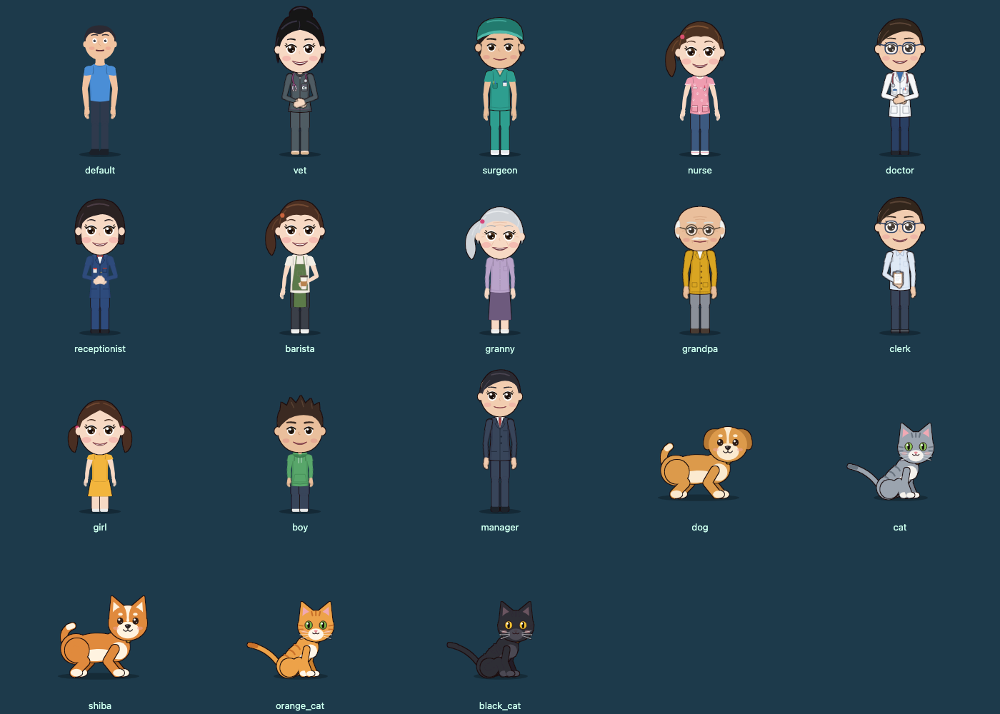

# character-skill-build

An agent skill for **building custom 2D characters** and **reusing them in
[HyperFrames](https://github.com/heygen-com/hyperframes) videos**.



Characters are 100% SVG, animated with GSAP. A character is a small JavaScript definition
on top of a shared skeleton, so every new character can already wave, talk, point, sit,
react, walk in, walk out and a dozen other things. Dogs and cats come with their own
actions (wag, bark, beg; meow, stretch, hiss…), five breeds and adjustable body shape.

- **`SKILL.md`** — instructions an AI agent follows to create a character from a brief,
  verify it, and place it in a composition.
- **`runtime/`** — the library (ES modules) with an English API.
- **`dist/character.slim.js`** — the same library as one plain-script file for HyperFrames,
  with the tuned configs baked in.
- **`studio/`** — a visual editor: presets, sliders, colour palettes, undo, per-character save.
- **`tools/`** — dev server, bundler, automated check, pose-sheet and composition previews.

## Install as a skill

```bash
git clone https://github.com/tinhthanh/character-skill-build ~/.claude/skills/character-build
```

Any agent that reads `SKILL.md`-style skills can use it the same way; the skill is just this
folder.

## Try it

```bash
python3 tools/serve.py                          # http://127.0.0.1:8300/studio/
sh tools/check.sh                               # every character × every action, headless → PASS / FAIL
sh tools/shot.sh receptionist /tmp/sheet.png    # pose sheet for one character
sh tools/peek.sh examples/hyperframes/index.html   # timings + contact sheet of a composition
```

## A character in a dozen lines

```js
// characters/pharmacist.js — then add it to characters/index.js
export default {
  id: 'pharmacist',
  base: 'surgeon',                                   // his head and proportions
  define: (base, kit) => ({
    ...base,
    ...kit.outfits.plainCoat,                        // long-sleeved coat (no stethoscope) instead of scrubs
    name: 'Pharmacist',
    hat: () => '',                                   // drop the inherited surgical cap
    faceExtras: (p, c) => kit.parts.roundGlasses(c),
    beard: (p, c) => kit.parts.shortBeard(c),
    colors: { ...base.colors, hair: '#8d9199', top: '#f6f7f9', topShadow: '#c9d0d9', innerShirt: '#2f9e8f' },
    restPose: { upperArmL: 10, upperArmR: 10, forearmL: -13, forearmR: -13, smile: 0.9 },
  }),
};
```

`references/slots.md` documents every key, coordinate system and required element id.

## In a HyperFrames composition

```html
<script src="https://cdn.jsdelivr.net/npm/gsap@3/dist/gsap.min.js"></script>
<script src="character.slim.js"></script>
<script>
  VGCharacter.seed(7);
  const rig = VGCharacter.createCharacter(document.getElementById('presenter'), { id: 'pharmacist' }).rig;
  const act = VGCharacter.sequence(rig, ['enter', 'wave', ['explain', 'Xin chào!', 2.4], ['express', 'happy']]);
  const tl = gsap.timeline({ paused: true });
  tl.add(act.paused(false), 0);
  window.__timelines = { ...(window.__timelines || {}), 'my-composition': tl };
</script>
```

## Requirements

Python 3 for the tools. Chrome or Chromium for `check.sh` / `shot.sh` / `peek.sh`. GSAP 3 is
loaded from a CDN by the pages here and by HyperFrames compositions. No Node, no bundler.

## Notes

- The public API, the definition and config schemas are English. The two rig files keep
  Vietnamese internal names and comments, and the studio UI is in Vietnamese;
  `runtime/schema.js` is the dictionary between the two.
- Verified with the HyperFrames CLI 0.9.52: `examples/hyperframes/index.html` passes
  `hyperframes lint` and `hyperframes check` with no errors and renders to a 15 s, 1920 × 1080,
  30 fps MP4 on parallel workers.
- See `CHANGELOG.md` for what changed between versions.
- Licensed under the MIT License (`LICENSE`). GSAP is loaded from a CDN and is not part of this
  repository; it has its own licence.

---

## Tiếng Việt

Skill hướng dẫn AI agent **tạo nhân vật 2D tuỳ chỉnh** (SVG thuần, GSAP điều khiển) và
**dùng lại nhân vật trong video HyperFrames**. Mỗi nhân vật là một tệp định nghĩa nhỏ trong
`characters/`, thừa hưởng bộ xương và 22 động tác có sẵn. Kèm chó, mèo (năm giống) với bộ
động tác riêng và hình dáng chỉnh được.

```bash
python3 tools/serve.py        # mở studio: http://127.0.0.1:8300/studio/
sh tools/check.sh             # kiểm mọi nhân vật × mọi động tác
python3 tools/build.py        # dựng lại dist/ cho HyperFrames (nướng luôn configs/)
```

Quy trình tạo nhân vật nằm trong `SKILL.md`; bảng khoá và toạ độ ở `references/slots.md`.
