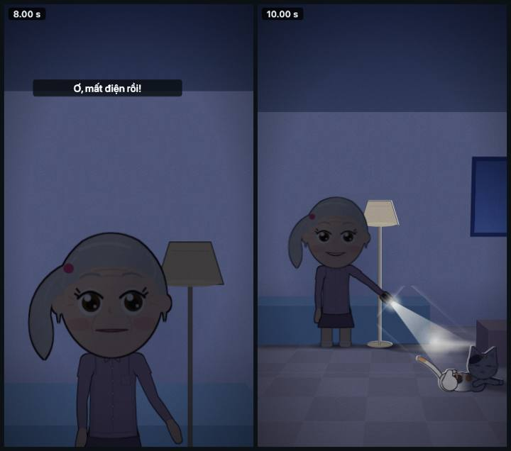

# Lighting — a guide for writing scenes

Everything here works in a 3D set (`"set"` in a scene file, or `bối cảnh:` in a script). The light is computed every
frame: characters walking past a lamp brighten and their shadows turn, and when the sky changes the whole room
changes with it. The code is in `runtime/lighting.js`; the moments it is checked on are in
[`tools/light_audit.py`](#checking-the-light).

Ready-to-run scripts: `examples/lighting/` — `python3 tools/script.py examples/lighting/dem-mat-dien.txt`.

## Time of day

| Script | Scene file | What you get |
|---|---|---|
| `ánh sáng: ngày` (default) | `"light": "day"` | even daylight, sunlit patches under windows, passing clouds |
| `ánh sáng: chiều` | `"light": "evening"` | warm, low sun: long shadows all one way, warm side and cool side on characters |
| `ánh sáng: tối` | `"light": "night"` | dark blue room and sky; lamps are the main light |
| `ánh sáng: chiều → tối` | `"light": "evening"` + `"sky"` on the middle turn | the sky darkens halfway through the scene and the lamps switch themselves on |

Turns that change the light in the middle of a scene:

| Script line | Scene file turn | |
|---|---|---|
| `bé: [trời tối dần]`, `[hoàng hôn]`, `[trời sáng]` | `"sky": "night"` or `{ "to": "night", "dur": 6 }` | the camera holds a wide shot (and pulls back slowly) until the lamps are on |
| `bà: [bật đèn]` / `[tắt đèn]` | `"lamp": "on"` / `"off"` | the lamp flickers on; the person walks to the switch if they say nothing |
| `bà: [mất điện]` / `[có điện]` | `"power": "off"` / `"on"` | every lamp and screen goes out at once / comes back one after the other |

*`chieu-cong-vien.txt`: long evening shadows; after nightfall the sky is dark, the street lamp lights a pool on the
grass.*

## Lamps, screens, windows

- **Lamps** come with the places: the floor lamp in `phòng khách`, street lamps in `công viên` and `đường phố`, an
  examining lamp over the table in `phòng khám`. Extra lamps: `"lamps": [{ "name", "x", "y", "z", "color",
  "power", "kind": "point" | "ceiling", "on" }]` in `"set"`.
- **Street lamps** at night throw a round pool of light on the ground; a character near one is brighter, with a
  faint glow of the lamp's colour round them, and a shadow pointing away from the lamp.
- **A TV** (`"tv"` cutout, in `phòng khách`) glows on the wall behind it in the colour of the picture, flickering
  with it, in the evening and at night.
- **Windows** (`"window": true` on a back-wall panel) light the room in the day: a sunlit patch on the floor, a
  shaft with dust, backlight on people standing in front of them. At night the glass is dark blue.

*A walk past two street lamps: darker between them, brighter next to one; the shadow turns as he passes.*

## Light in the hand

| Script | Scene file | |
|---|---|---|
| `bà → mèo: rọi đèn` | `["shine", "@meo"]` | a flashlight: a soft beam aimed at the pet on every frame, the pet lit and squinting, its shadow thrown away from the hand, a pool of light on the floor or wall in the dark |
| `bác sĩ → mèo: khám` | `["examine", "@meo", "teeth"]` | the examining light: a small glint and a hotspot on the pet, which squints |

*`dem-mat-dien.txt`: the power goes out, granny shines a flashlight at the cat.*

## Shadows and the look of the frame

- Every character and every piece of furniture casts a soft shadow under it and a long one away from each light:
  dark and sharp at the feet, paler and blurred towards the tail; a long shadow that reaches a wall climbs it.
- The floor reflects its colour onto legs and bellies (strongest in a patch of sunlight).
- The **lens layer** grades the colour by time of day, darkens the corners and adds film grain.
  `"lens": false` in `"set"` turns all of it off; `"grain": false` drops only the grain.
- **A film** (`tools/film.py`) adds the grain itself when it joins the parts (`"grain": "post"`, the default): the
  scenes render without their grain layer — about 25 % faster — and the film is several times smaller, with the
  same amount of grain. `"grain": "page"` keeps each scene's own layer, `"none"` leaves grain out.
- `"shading": false` in `"set"` turns off the light and shade on the characters' bodies.

## Tips

- In a vertical frame (`khung: dọc`) half the frame is above the walls: the sky changes with the time of day, so
  night scenes stay dark.
- Characters standing at different depths (granny on the sofa, the cat on the floor in front) are framed by where
  they appear on screen: a close shot of the cat either leaves granny out completely or takes her whole head in.
- A turn where someone walks cuts to a new shot after 1 s, so they do not walk out of the old one.

## Checking the light

`tools/scene.py` writes `moments.json` next to a 3D scene (`light_moments`, tools/scenelib/lighting.py): the moments that matter for the light, each with
questions whose right answer is "yes". `python3 tools/light_audit.py <scene dirs…> -o audit/` captures them as
sheets and writes `audit/prompt.txt`; answer the questions (or hand the sheets and the prompt to a reviewer), then
`python3 tools/light_audit.py --score answers.json -o audit/`. A question about something not in the frame may be
answered `n/a`. `python3 tools/light_audit.py --report -o audit/` writes `audit/report.html`: each sheet with every
reviewer's answers (all `answers*.json`), failures in red, and the score history.

The same `moments.json` also holds the **acting** moments: every turn where a hand must reach something (stroke,
examine, give a treat, brush, listen, inject: the pet; hand over, handshake: the other person's hand) and every
walk, with questions for the reviewer and a `check` for the machine. `python3 tools/acting_check.py <scene dirs…>`
opens each scene, seeks to three moments of each of those actions (40 / 55 / 70 % of the action itself, not of the
turn — a turn can wait for the camera before the hand moves; a pick-up: 35 / 82 / 95 %, once the pet is up) and
measures at the middle one, the moment the reviewer is asked about: the hand must come within 6 % of the person's
height of the pet's head or body (or of the other hand), a picked-up pet must be against the chest (also at the
last moment), and feet must stay within 3 % of the floor.
The hand is measured to the parts of the pet you can see — a grid over its drawn head and body, less what a person's legs
in front of it hide — not to its framing box (that box reached behind a seated person's knee, so a hand resting on her
own knee "touched" the cat); a seated person's hand must not rest on their own thigh or knee. After `putDown` the pet
must be on the floor next to the person who put it down (within 12 % of their height) and stay there. At every moment
of `moments.json` no piece of furniture (sofa, table, TV stand, TV, counter) may be cut, or touched, by the left or
right edge of the frame (`set.propFraming()`; foreground props excepted).
A pet a hand touches (stroke, examine, treat…) must be in view at the moment asked about: from three captures (as is,
without the pet, the pet drawn on top of everything) at least 70 % of it and 60 % of its head show, and from two more
(the toucher on top, then with the hands painted) at least 70 % of the touching hand shows and at least 5 % of it lies
on or against the pet (a hand in view that hovers beside it is not a touch). A seated person leans at most
25° to reach a pet on the floor. Every medium shot the automatic camera chose (`set.shotLog`) must be narrower than
85 % of the full shot of the same subjects — a cut to it would barely change the frame — and none may be kept as the full
shot (the last line counts them). A stroke is followed every 0.1 s over the strokes (`track` in `moments.json`): the hand
stays on or against the pet at every moment (≥ 15 % of it) and no more than 10 % of it sinks past the pet's outline. A
hand smaller than 1000 px in the capture (a very wide shot) is measured again at twice the resolution — at 1× its
antialiased rim alone reads as several per cent sunk.
A hand gesture (wave, point, thumbs up, cheer, call out…) is measured at the moment asked about: both hands of the person
must lie inside the frame, at least 5 % of the hand's width from its left, right and top edges ( a hand below the bottom edge, hanging at the hip under a
medium shot, is left out). A pet's own turn (scared, startled…) is measured in the frame at its middle, and when it follows
an insert of that pet (after a single shot of the person acting) the insert must hold until the turn ends. A pet moved
into another person's plane (`set.depthLog`) must never change depth while it stands still in view with no cut.
It exits 1 on a miss — `tools/check_scene.py` runs it on a small clinic scene, a park scene, a living-room scene, a vertical
power-cut scene, granny and a boy at two depths reaching for one cat (with the automatic camera, and with a still camera,
where the cat must change depth during its own walk), a boy waving and pointing in a vertical frame, and the vet and a
boy in a vertical park (the boy's narrow cheer must keep the medium shot, no cut to the full shot).

What the scene tool now does for the acting, so the measurements pass without extra script lines:

- A person **kneels** to stroke, feed, examine or brush a pet on the floor (standing, the hand only reaches its back).
- Someone already standing where a newcomer needs to be next to a pet **steps aside** first.
- `bác sĩ → bé: bắt tay` makes the other person **shake hands back**; they stand close enough for the short arms to
  meet, and the shot is a full one, so the hands are in it.
- In a vertical frame the living room is laid out tighter (shorter sofa, TV nearer), so a full shot holds both.
- `bé → ông: đưa` (`handOver`) makes the other person **take** it at the same time (when they have the item put
  away), and `trao` (`handOverPet`) adds the other's `takePet`; both reach for the point between their shoulders, like a
  handshake, and the item sits in the hand on the receiver's side.
- A pet walks over to a **seated** person who strokes or picks it up and stops on the side it comes from, 0.22 × their
  height away. On the knee side it stands **in front of their shins**, drawn over that person (`set.place(pet, { over:
  person })`), and the hand rests on the top edge of its head (`set.target(…, 'crown')`); on the hip side the person is
  drawn in front and the hand rests on the top of its head (`'top'`). The person leans towards it at most 25°.
- A pet handed over (`trao`) and put down by the receiver lands next to the receiver's feet, on the side away from
  the giver — not back where it was first picked up.
- When the automatic medium shot of two subjects is almost as wide as their full shot (≥ 85 %, mostly to keep furniture
  whole), the camera lets furniture that nobody uses (a coffee table — not the TV, not the sofa someone sits on) touch the
  frame edge and stays at 80 % of the full shot; failing that it frames the person acting and the pet at the moment of
  the action; only when even that is too wide (or would cut the pet) does it keep the full shot instead of cutting to a
  near copy. `tools/scene.py` says when a medium shot is still that wide. In a vertical frame two subjects far apart
  get a single shot of the person acting instead; medium shots of a person are framed on the upper body (a seated
  person's knees do not widen them), and the vertical full shot leaves room around the person (66 % of the height).
- A pet that two people at different depths reach for (granny on the sofa strokes the cat, then the boy kneels to feed
  it) moves into the plane of whoever reaches for it before their turn — on a cut, or during its own walk: the scene tool
  gives the pet a short walk toward the next person (a few steps), and its depth follows its steps (it never slides
  while its feet stand still, even with no cut)
  (`set.depth` + `set.settleDepths`).
- A medium or close shot of a turn with a hand gesture takes in both hands at the moment of the gesture, staying within
  83 % of the full shot (sliding toward the gesturing hand); a shot that already shows the hands is kept. In a vertical
  frame a person cheers narrow (`cheer({ narrow: true })`: fists pumped beside the shoulders), so the medium shot holds
  both hands; when no medium shot can hold a gesture's hands, that beat gets the full shot with both hands.
- The insert of the pet after a single shot of the person acting holds through the pet's reaction on the next turn,
  framed for both moments, instead of cutting to a new shot of the same pet.
- A stroke glides: the hand slides along the top of the pet's head, its underside on one line, instead of rocking up
  off it and down behind it.
  `acting_check` also measures that a carried pet is in the arms and that a seated person sits on the seat
  (within 3 % of their height of the top of the sofa / bench).

## One side brighter

The light on a character's body comes from one side: the half facing the main light (a lamp, the window, the sun) is
brighter — warmed by it in daylight — and the other half darker and cooler. `python3 tools/light_side.py <scene dirs…>`
measures it on the opening frame (where the reviewer is asked): it captures the frame, the frame without the
characters (to find their pixels) and the frame without the body shading, and compares the brightness of the two
halves of each person's head and upper body. The half facing the light must be at least 8 % brighter (or the shading
must add 8 %). Backlit people (a bright window or lamp behind at least 20 % of their head and upper body) and people at night with no lamp near are reported but not
judged. `--all` measures at the acting moments too.
