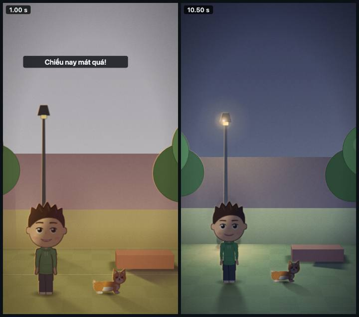
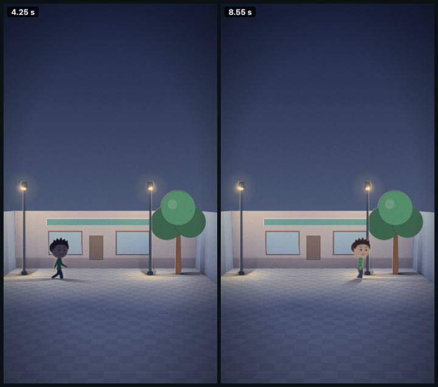
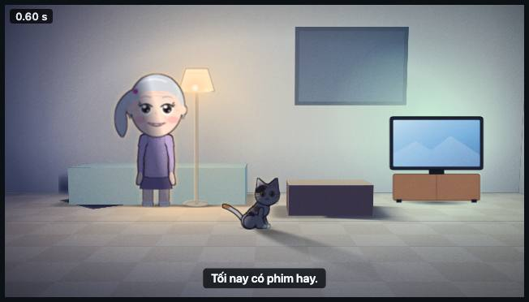
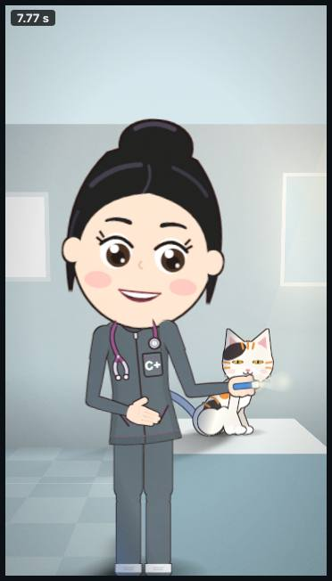

# Lighting — a guide for writing scenes

Everything here works in a 3D set (`"set"` in a scene file, or `bối cảnh:` in a script). The light is computed every
frame: characters walking past a lamp brighten and their shadows turn, and when the sky changes the whole room
changes with it. The code is in `runtime/lighting.js`; the moments it is checked on are in
[`tools/light_audit.py`](#checking-the-light).

Ready-to-run scripts: `examples/lighting/` — `python3 tools/script.py examples/lighting/dem-mat-dien.txt`.

## Time of day

| Script | Scene file | What you get |
|---|---|---|
| `ánh sáng: ngày` (default) | `"light": "day"` | even daylight, sunlit patches under windows, passing clouds |
| `ánh sáng: chiều` | `"light": "evening"` | warm, low sun: long shadows all one way, warm side and cool side on characters |
| `ánh sáng: tối` | `"light": "night"` | dark blue room and sky; lamps are the main light |
| `ánh sáng: chiều → tối` | `"light": "evening"` + `"sky"` on the middle turn | the sky darkens halfway through the scene and the lamps switch themselves on |

Turns that change the light in the middle of a scene:

| Script line | Scene file turn | |
|---|---|---|
| `bé: [trời tối dần]`, `[hoàng hôn]`, `[trời sáng]` | `"sky": "night"` or `{ "to": "night", "dur": 6 }` | the camera holds a wide shot (and pulls back slowly) until the lamps are on |
| `bà: [bật đèn]` / `[tắt đèn]` | `"lamp": "on"` / `"off"` | the lamp flickers on; the person walks to the switch if they say nothing |
| `bà: [mất điện]` / `[có điện]` | `"power": "off"` / `"on"` | every lamp and screen goes out at once / comes back one after the other |

*`chieu-cong-vien.txt`: long evening shadows; after nightfall the sky is dark, the street lamp lights a pool on the
grass.*

## Lamps, screens, windows

- **Lamps** come with the places: the floor lamp in `phòng khách`, street lamps in `công viên` and `đường phố`, an
  examining lamp over the table in `phòng khám`. Extra lamps: `"lamps": [{ "name", "x", "y", "z", "color",
  "power", "kind": "point" | "ceiling", "on" }]` in `"set"`.
- **Street lamps** at night throw a round pool of light on the ground; a character near one is brighter, with a
  faint glow of the lamp's colour round them, and a shadow pointing away from the lamp.
- **A TV** (`"tv"` cutout, in `phòng khách`) glows on the wall behind it in the colour of the picture, flickering
  with it, in the evening and at night.
- **Windows** (`"window": true` on a back-wall panel) light the room in the day: a sunlit patch on the floor, a
  shaft with dust, backlight on people standing in front of them. At night the glass is dark blue.

*A walk past two street lamps: darker between them, brighter next to one; the shadow turns as he passes.*

## Light in the hand

| Script | Scene file | |
|---|---|---|
| `bà → mèo: rọi đèn` | `["shine", "@meo"]` | a flashlight: a soft beam aimed at the pet on every frame, the pet lit and squinting, its shadow thrown away from the hand, a pool of light on the floor or wall in the dark |
| `bác sĩ → mèo: khám` | `["examine", "@meo", "teeth"]` | the examining light: a small glint and a hotspot on the pet, which squints |

*`dem-mat-dien.txt`: the power goes out, granny shines a flashlight at the cat.*

## Shadows and the look of the frame

- Every character and every piece of furniture casts a soft shadow under it and a long one away from each light:
  dark and sharp at the feet, paler and blurred towards the tail; a long shadow that reaches a wall climbs it.
- The floor reflects its colour onto legs and bellies (strongest in a patch of sunlight).
- The **lens layer** grades the colour by time of day, darkens the corners and adds film grain.
  `"lens": false` in `"set"` turns all of it off; `"grain": false` drops only the grain — about 20 % faster to
  render, for drafts.
- `"shading": false` in `"set"` turns off the light and shade on the characters' bodies.

## Tips

- In a vertical frame (`khung: dọc`) half the frame is above the walls: the sky changes with the time of day, so
  night scenes stay dark.
- Characters standing at different depths (granny on the sofa, the cat on the floor in front) are framed by where
  they appear on screen: a close shot of the cat either leaves granny out completely or takes her whole head in.
- A turn where someone walks cuts to a new shot after 1 s, so they do not walk out of the old one.

## Checking the light

`tools/scene.py` writes `moments.json` next to a 3D scene: the moments that matter for the light, each with
questions whose right answer is "yes". `python3 tools/light_audit.py <scene dirs…> -o audit/` captures them as
sheets and writes `audit/prompt.txt`; answer the questions (or hand the sheets and the prompt to a reviewer), then
`python3 tools/light_audit.py --score answers.json -o audit/`. A question about something not in the frame may be
answered `n/a`.
